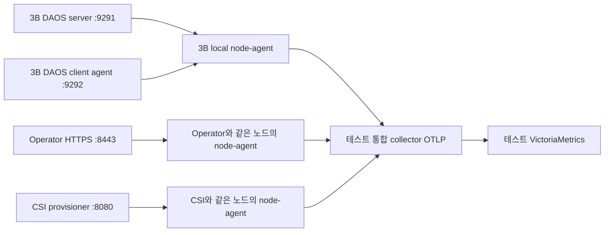

# GPUFlow telemetry test (2026-11-01)

레인 A에 추가한 텔레미트리 검증 환경이다. 원래 `daos` 시스템은 rank가 adminexcluded 상태라 그대로 두고,
`telemetry-lab`을 exaci5-3b에 새로 구성했다. 실제 디스크를 포맷하지 않고 전용 경로의 8 GiB 파일 bdev를 사용한다.

## 추가한 기능

- `spec.clientAgent.telemetry.enabled` / `port` (기본 9192): 노드별 DAOS agent의 native exporter.
  별도 `<system>-agent-telemetry` ConfigMap으로 CSI·관리 Job의 agent와 HTTP 포트 충돌을 방지한다.
  설정 hash가 바뀌면 agent가 재시작하며, 끄면 Service·전용 ConfigMap·port·IPC/PID 옵션을 제거한다.
- telemetry를 켠 agent는 `hostIPC`와 `hostPID`를 사용한다. 다른 Pod의 클라이언트 공유 메모리와
  SO_PEERCRED PID/NUMA/프로세스 수명을 확인하기 위해 필요하다. 클라이언트 Pod도 `hostIPC: true`와
  해당 agent 소켓을 사용해야 한다. 일반 sidecar 설정은 바뀌지 않는다.
- Helm `metrics.enabled`: Operator HTTPS endpoint와 Service, TokenReview/SubjectAccessReview 권한.
  수집 SA에는 별도로 `/metrics` GET 권한을 부여한다. 기본 비활성, 활성화 시 인증 유지.
- Helm `csi.metrics.enabled`: external-provisioner의 HTTP endpoint와 Service.
  [upstream v5.2.0 HTTP endpoint](https://github.com/kubernetes-csi/external-provisioner/blob/v5.2.0/README.md#http-endpoint).
  CSI provisioning 지표이며 DAOS I/O 성능이나 CSI node mount 지표와는 다르다.



`pipeline.yaml`은 각 노드의 agent가 해당 노드의 exporter를 수집한다. Operator·CSI Pod discovery는
`spec.nodeName`으로 제한한다. 원본의 용량·대기열·버퍼·오류·지연 통계를 선별 수집하고,
기존 GPUFlow read/write bytes와 operation 카운터 3종을 함께 생성한다.
client_io의 thread별 지표는 제외하고 client_dfs와 일부 client_pool을 수집한다.

## 현재 배치

| 항목 | 구성 |
|---|---|
| Kubeconfig | `~/.kube/daos-ci.conf` (레인 A) |
| DAOS | `daos-system/telemetry-lab-server-exaci5-3b-0`, system name `gpftelemetry` |
| NUMA / hugepage | node 0, 기존 8 GiB 중 Pod에 2 GiB 요청, `nrHugepages: 1024` |
| SCM / bdev | RAM SCM 4 GiB / file 8 GiB, TCP ens19, 1 rank·1 target |
| 파일 경로 | `/var/daos/gpuflow-telemetry-lab`, 로그 `/var/log/daos/gpuflow-telemetry-lab` |
| 소켓 | `/var/run/daos-operator/agent/telemetry-lab` |
| 관리 / fabric / server metrics / client metrics | 10121 / 31926 / 9291 / 9292 |
| Pool / container | `telemetry-lab-pool` 4 GiB / `telemetry-io`, rf=0, SX/S1 |
| 클라이언트 | `daos-system/telemetry-io`, dfuse caching disabled |
| 수집 / DB | `gpuflow-telemetry-test`, 4 node-agent Pods + collector + VictoriaMetrics |
| 이미지 | `registry.gitlab.gluesys.com/exastor/daos-operator/daos-operator:telemetry-20261101-r2` |
| 이미지 digest | `sha256:82603c371c2215c523d31b263ef54e34cac8ad07dd48850bb33b4ec82c03989a` |

초기 1 GiB hugepage에서는 DMA buffer 생성이 DER_NOMEM으로 실패했다. 2 GiB로 올린 뒤 rank가 정상 합류했다.
DAOS system name은 최대 15자이며 이 빌드의 RAM SCM 최소 크기는 4 GiB이다.
hostprep은 꺼져 있어 호스트 hugepage 배치와 NVMe 바인딩을 변경하지 않는다.

## 재현 순서

기존 release 값을 보존하고 `operator-values.yaml`을 overlay로 사용한다. 기존 CRD 업그레이드는
생성된 CRD의 `spec.clientAgent.telemetry` 스키마만 JSON Patch로 추가했다.
새 설치에는 차트의 생성된 CRD가 포함된다. Helm의 기본 watcher는 원래 `daos`의 Ready=False까지 기다리므로
이번 업데이트에는 `--wait=legacy`를 사용하고 새 인스턴스의 Ready를 별도로 확인했다.

```bash
export KUBECONFIG="$HOME/.kube/daos-ci.conf"
kubectl apply -f deploy/telemetry-test/pipeline.yaml
kubectl apply -f deploy/telemetry-test/system.yaml
# 새 전용 파일 경로임을 확인한 뒤 최초 포맷 승인 (기존 DAOS 디스크에는 사용하지 않는다)
kubectl annotate daossystem telemetry-lab daos.gluesys.com/format-approved=true
kubectl wait --for=condition=Ready daossystem/telemetry-lab --timeout=180s
kubectl apply -f deploy/telemetry-test/pool.yaml
kubectl wait --for=condition=Ready daospool/telemetry-lab-pool --timeout=180s
kubectl wait -n daos-system --for=jsonpath='{.status.ready}'=true daoscontainer/telemetry-io --timeout=180s
kubectl apply -f deploy/telemetry-test/client.yaml
kubectl wait -n daos-system --for=condition=Ready pod/telemetry-io --timeout=120s
kubectl exec -i -n daos-system telemetry-io -- bash < deploy/telemetry-test/io-check.sh
kubectl apply -f deploy/telemetry-test/csi-probe.yaml
kubectl wait -n daos-system --for=jsonpath='{.status.phase}'=Bound pvc/telemetry-csi-probe --timeout=180s
kubectl delete pvc -n daos-system telemetry-csi-probe
kubectl port-forward -n gpuflow-telemetry-test svc/victoriametrics 18438:8428
# 다른 터미널에서, scrape/전송이 끝난 뒤 실행
python3 deploy/telemetry-test/verify.py --output /tmp/telemetry-verification.json
```

## 확인 결과

- `make test`: 전체 통과, controller coverage 83.3%. 변경분 lint 0 issues.
  `make lint-fix`는 저장소 기존 lint 위반으로 전체 통과하지 않으며, 무관한 자동 수정은 되돌렸다.
- Helm lint 및 Kubernetes server dry-run 통과. Helm release revision 3, deployed.
- server/client/operator/CSI `up=1`, 네 경로 모두 local agent → collector → DB 확인.
- Operator 무인증 `/metrics`: HTTP 401. 수집 SA 인증 요청은 정상 수집.
- 32 MiB 파일 3회 write/read, SHA-256 일치. server write +100,663,296 B,
  server read +100,665,304 B (메타데이터 포함). DFS client read/write 각각 +100,663,296 B.
- 이 빌드의 `client_dfs_{read,write}_bytes`는 요청 크기 histogram이다. 총 byte는 `_sum`으로 조회한다.
  지연 histogram이 아니므로 여기서 지연 p95/p99를 계산하지 않는다.
- CSI PVC Bound 확인 후 삭제. `CreateVolume` OK 1 / `DeleteVolume` OK 1 확인.
  최초 pool 준비 전 CreateVolume Unavailable 4회는 준비 후 재시도로 성공했다. CSI mount I/O 시험은 아니다.
- 초기 생성 시 pool/container 중복 생성 Job의 already-exists 오류가 있었지만 이후 조회로 정상 Ready에 수렴했다.
  기존 컨트롤러 동작 관찰 사항으로 전달하며, 이번 telemetry 패치의 수정 범위에는 포함하지 않았다.

원시 응답·I/O 로그·DB 검증 JSON은 작업 PC의
`/home/hgichon/src/Flexa/reports/daos-operator-telemetry-20261101/validation/`에 보관한다.

## 범위와 정리

파일 bdev여서 NVMe SMART/온도·마모를 검증하지 않았다. 서버 지연 평균/max는 수집하지만
지연 p95/p99에 필요한 histogram은 추가 계측이 필요하다. 테스트 DB는 emptyDir, retention 1일이며
재생성 시 데이터가 사라진다. 테스트 내부 OTLP는 평문이고 Operator self-signed TLS 검증을 건너뛰므로
운영 배포에는 신뢰 CA와 기존 GPUFlow mTLS 구성을 적용해야 한다. J 대시보드 연결은 별도 단계이다.

테스트 CSI PVC는 삭제했다. dfuse와 테스트 DAOS/수집 서비스는 재확인할 수 있도록 유지한다.
정리할 때는 client Pod → 테스트 container/pool → telemetry-lab 순서로 삭제하고,
이 테스트의 namespace/RBAC/StorageClass를 제거한다. 데이터 경로는 CR 삭제만으로 자동 제거되지 않는다.
Operator 기능을 되돌릴 때는 기존 Helm revision 1로 rollback할 수 있지만, 먼저 telemetry-lab과
client agent를 정리해야 한다. 원래 `daos`와 기존 CSI 볼륨은 정리 대상이 아니다.
